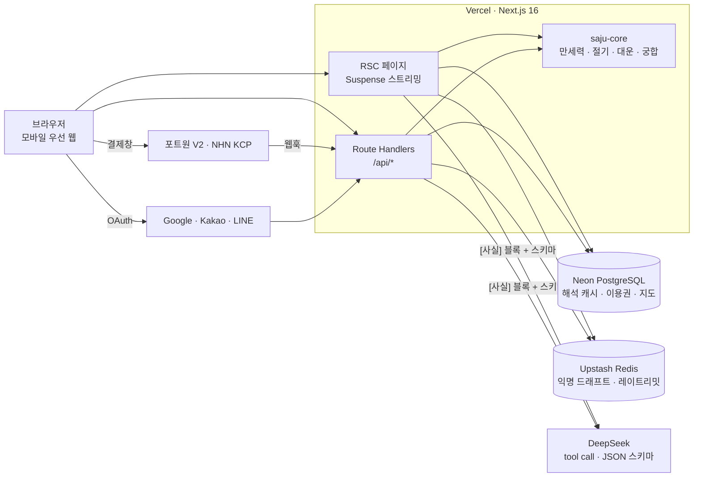
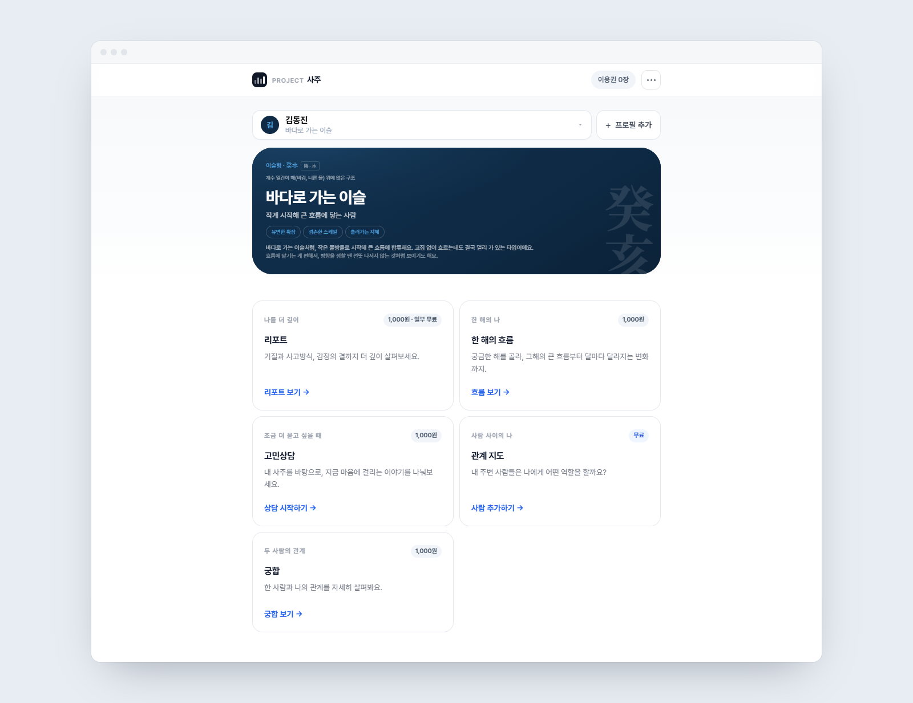
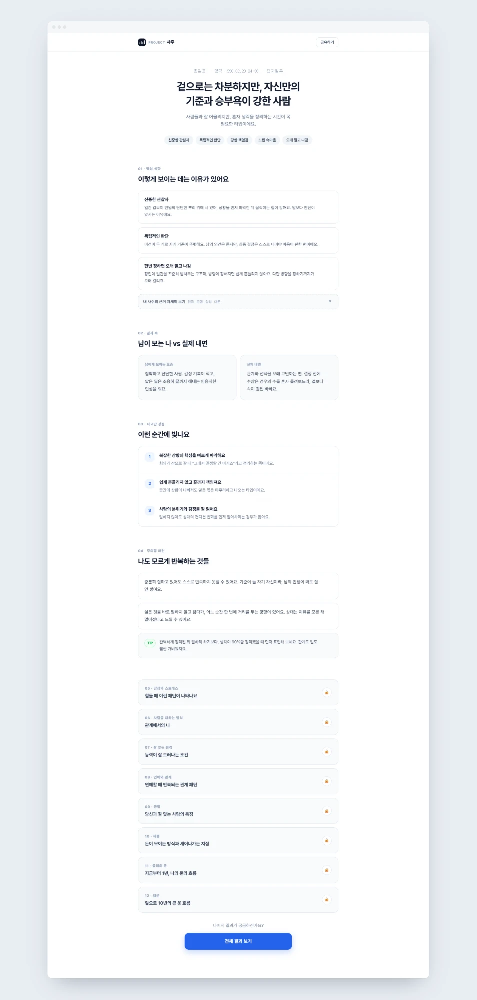
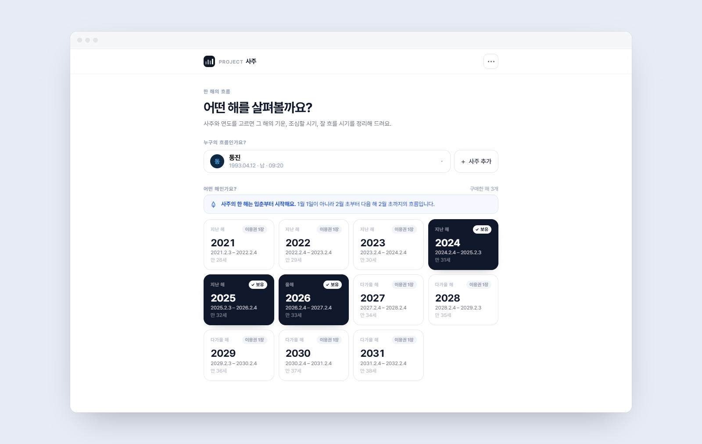
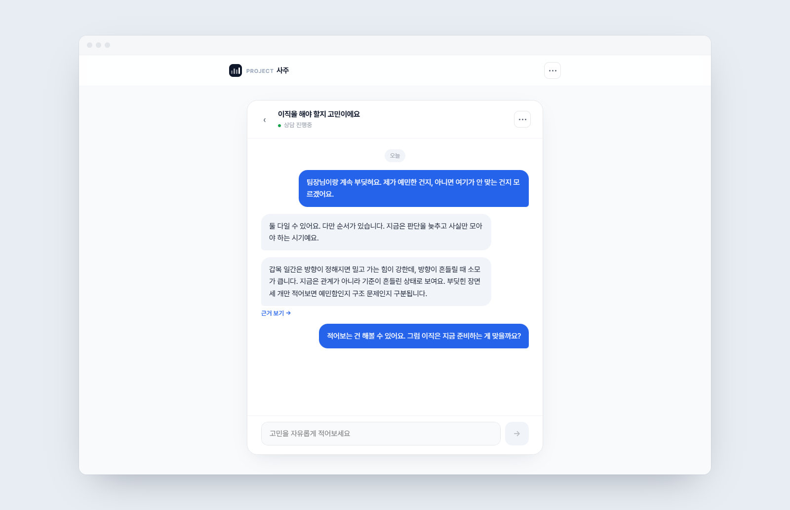

# 프로젝트 사주

많은 사주 서비스들은 동양풍 장식 같은 화려한 이미지나 애니메이션, 링크로 가득 채워진 화면이 많다. 컨셉이 내용을 가리고, 내용은 정리되지 않은 채 나온다. 결과는 긴 글 한 덩어리로 나오거나 어려운 사주 용어가 섞여 맥락을 읽기 쉽지 않는다.

프로젝트 사주는 사주를 깔끔하게 읽을 수 있는 화면을 만들고 싶어서 시작했다. 장식 대신 여백과 위계로 정리하고, 리포트는 섹션으로 나눈다.

https://www.project-saju.com/

- 모바일 우선 웹 (Next.js, Vercel)
- 2026년 6월부터 개발
- 1인 개발

## 기술

- 프런트: Next.js 16 (App Router, RSC, Suspense 스트리밍), React 19, TypeScript, Tailwind 4, three.js (React Three Fiber)
- 서버: Next.js Route Handlers, PostgreSQL (Neon), Upstash Redis, Zod 4, jose
- 외부: DeepSeek (tool call), 포트원 V2 + NHN KCP, Google · Kakao · LINE OAuth, Resend

### 고민했던 것

- **LLM 출력은 프롬프트로 부탁하지 않고 스키마로 강제한다.** 섹션마다 Zod 스키마 하나를 두고 거기서 TS 타입, tool call용 JSON 스키마, 저장 전 파서를 모두 파생시킨다. 화면이 읽는 타입과 모델이 받는 스키마가 같은 객체에서 나오므로 어긋날 수 없다. 검증은 어댑터가 아니라 저장 직전 한 곳에서 건다. 스키마에 맞지 않는 응답은 그 섹션만 버리고 나머지는 저장한다. 화면은 확보한 섹션만 보여주고, 빠진 섹션은 다음 방문에 캐시 누락으로 잡혀 다시 생성된다. 상담처럼 섹션 단위로 나눌 수 없는 응답은 그 턴을 버린다. 첫 턴이면 이용권을 되돌리고, 이후 턴이면 사용자가 다시 보낸다.
- **돈이 움직이는 경로는 SQL 한 문장이다.** Neon HTTP 드라이버는 대화형 트랜잭션(`BEGIN` → 판단 → `COMMIT`)이 없다. 그래서 "잔액을 읽고 판단하고 차감"을 앱에서 하지 않고, 권한 생성·차감·원장 기록을 CTE 한 문장에 넣었다. 중복 요청은 `UNIQUE`가, 동시 차감은 `CHECK (balance >= 0)`가 문장 전체를 되돌린다. 결제 확정도 조건부 `UPDATE` 하나라 웹훅과 완료 API가 같은 결제를 동시에 확정하러 와도 이긴 쪽만 적립한다. 정확성의 근거가 앱 코드가 아니라 스키마 제약에 있다.
- **익명 입력은 Redis에, 쿠키에는 토큰만.** 로그인 전에 입력한 생년월일시를 쿠키나 URL에 싣지 않는다. 값은 Redis에 두고 httpOnly 쿠키가 불투명한 토큰만 나른다. OAuth 콜백이 그 토큰으로 프로필을 만들어 승격시키므로, 무료 리포트를 본 사람이 로그인하면 재입력 없이 같은 프로필로 이어진다. 익명 생성 경로에는 IP당 시간당 10회 한도를 씌운다. 계정이 없어도 LLM 생성을 일으킬 수 있는 경로라, 생년월일을 바꿔 가며 무한히 생성하는 것을 막는 것이다. 카운터는 Redis에 두고 실제로 생성이 일어나는 순간에만 센다. Redis 장애 시에는 열지 않고 닫는다(fail-closed). 열어 두면 장애가 곧 무제한 LLM 호출이 되기 때문이다.

## 구조

리포트 순서: 생년월일시·출생지 입력 → 만세력 원국 (진태양시 보정) → 오행·십성·신강신약·용신·대운 계산 → `[사실]` 블록 → 섹션별 DeepSeek tool call → Zod 검증 → 원국 단위 캐시 → 화면

---

### 폴더 구조

- `src/lib/saju-core` — 계산 엔진. 외부 I/O 없는 순수 TypeScript. 원국, 절기, 대운, 세운, 60캐릭터, 관계 분류, 궁합 계산
- `src/app` — 라우트. 퍼널 → 리빌 → 홈 → 리포트 · 지도 · 궁합 · 상담 · 흐름 · 결제. 각 라우트의 `_lib`은 순수 함수라 node 환경에서 테스트한다
- `src/app/api/*/_lib/sections` — 섹션 레지스트리. Zod 선언 하나에서 TS 타입, LLM JSON 스키마, 런타임 파서가 파생된다
- `src/lib/{auth,tickets,payments,consultations,flows,matches,maps,profiles,drafts,support}` — 도메인별 규칙과 저장소. 저장소는 SQL 클라이언트를 주입받아 테스트가 DB 없이 돈다
- `migrations/` — SQL 파일 하나에 문장 하나 (Neon HTTP 드라이버 제약). `scripts/migrate.mts`가 파일명 순으로 적용
- `scripts/` — 상담·리포트 품질 평가, 지도 목 데이터 시드, 변곡점 임계값 분포 스윕
- `docs/` — PRD, 이슈, 설계 스펙과 구현 플랜, 기술 노트 (`docs/issues/db-transactions.md`)

## 주요 기능 및 화면

- 소셜 로그인 (Google · Kakao · LINE)
- 사주 입력: 양력·음력·윤달, 출생 시간 미상, 출생지 경도 보정
- 로그인 전 무료 체험: 입력값을 임시 보관했다가 로그인 시 프로필로 승격
- 프로필 관리: 계정당 여러 명 저장, 기본 프로필 지정, 삭제
- 일주 60캐릭터 카드
- 사주 리포트 (13섹션, 무료 5 · 유료 8)
- 한 해의 흐름 (연도 선택, 월별 정리)
- 고민 상담 (채팅, 1건 10턴)
- 관계 지도 (공유 링크로 누구나 사람 추가)
- 궁합 (관계 유형 10가지)
- 이용권 충전·결제 (포트원 · NHN KCP), 부분 환불
- 고객 문의: 오류 문의 · 피드백 · 환불 요청, 접수 시 메일 알림
- 이용약관 · 개인정보처리방침 · 사업자 정보

**홈** 내 캐릭터 카드와 리포트 · 한 해의 흐름 · 고민상담 · 관계 지도 · 궁합 입구.

**사주 리포트** 13섹션, 무료 5 · 유료 8. 섹션마다 계산 근거를 펼쳐 볼 수 있다.

**한 해의 흐름** 연도를 고르면 그 해의 흐름을 월별로 정리한다. 사주의 한 해는 입춘부터라 카드에 실제 기간을 적는다.

**고민 상담** 내 사주를 아는 상담자와 채팅. 상담 1건에 10턴.

